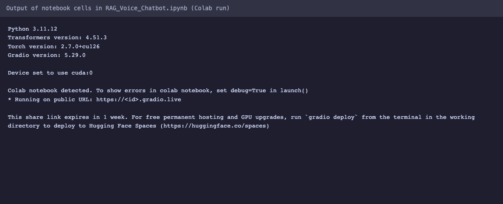

# Voice RAG Chatbot

This project demonstrates a Voice RAG (Retrieval-Augmented Generation) Chatbot that allows users to interact with a large language model (Mistral-7B) using voice input and receive voice responses. The chatbot retrieves relevant information from uploaded PDF documents to provide context-aware answers. Here’s a short video demonstrating the UI - https://www.youtube.com/watch?v=DAJgfzRsfBs



*Captured output of the `RAG_Voice_Chatbot.ipynb` cells from a Colab GPU run (the app itself needs a GPU and a 7B model, so it was not re-run locally).*

## Features

- Upload multiple PDF files to create a knowledge base
- Speak your question using the microphone
- Transcribe the audio input into text using the Whisper ASR model
- Retrieve relevant context from the uploaded PDFs using Qdrant vector store
- Generate a response using the Mistral-7B language model
- Convert the generated response into audio using the WheelSpeech TTS model
- Play the audio response directly in the notebook or through the API

## Requirements

- Python 3.x
- Transformers library
- Torch library
- Langchain library
- Gradio library
- Whisper library
- WhisperSpeech library
- Flask library

## Installation

1. Clone the repository:

   ```
   git clone https://github.com/moneebullah25/RAG_Voice_Chatbot.git
   ```

2. Install the required dependencies:

   ```
   pip install -r requirements.txt
   ```

   Note: `requirements.txt` is a full Colab environment freeze (it includes CUDA-only wheels such as `cudf-cu12`), so it installs reliably only on a Colab-like Linux/CUDA machine.

3. The Mistral model is gated on Hugging Face. Replace `YOUR_HF_TOKEN` in the notebook `login(...)` cell with your own token (never commit it).

## Usage

### Jupyter Notebook

1. Open the Jupyter Notebook (`app.ipynb`) and execute the code cells.
2. Upload one or more PDF files using the file uploader component.
3. Click the "Submit Audio" button and speak your question into the microphone.
4. The chatbot will transcribe your audio input, retrieve relevant context from the uploaded PDFs, generate a response, and play the audio response.
5. To clear all inputs and outputs, click the "Clear All" button.

### Flask API

1. Start the Flask server:

   ```
   python flask_app.py          # set FLASK_DEBUG=1 to enable the debugger (local use only)
   ```

2. The API provides the following endpoints:

   - `/upload_pdfs` (POST): Upload PDF files to create a knowledge base.
     - Request body: JSON object with the key `file_paths` containing an array of file paths.
     - Response: JSON object with a success message or an error message.
     - Example cURL command:
       ```
       curl -X POST \
         -H "Content-Type: application/json" \
         -d '{"file_paths":["path_to_file1.pdf","path_to_file2.pdf"]}' \
         http://localhost:5000/upload_pdfs
       ```

   - `/process_audio` (POST): Process audio input, generate a response, and return the response as audio.
     - Request body: JSON object with the keys `audio_path` (path to the audio file) and `output_filename` (desired filename for the generated audio response).
     - Response: JSON object with the keys `transcription` (transcribed text), `response_text` (generated response), and `audio_output` (path to the generated audio file).
     - Example cURL command:
       ```
       curl -X POST \
         -H "Content-Type: application/json" \
         -d '{"audio_path":"path_to_input_query.wav", "output_filename":"output_filename.wav"}' \
         http://localhost:5000/process_audio
       ```

3. You can use tools like cURL or Postman to make requests to the API endpoints.

## Functions

- `load_llm()`: Loads the Mistral-7B language model for text generation.
- `text_splitter()`: Creates a RecursiveCharacterTextSplitter for splitting long documents into chunks.
- `add_pdfs_to_vectorstore(files)`: Processes uploaded PDF files and adds them to the Qdrant vector store.
- `answer_query(message)`: Retrieves relevant context based on the user's question and generates a response using the language model.
- `transcribe(audio)`: Transcribes the user's audio input into text using the Whisper ASR model.
- `generate_and_play_audio(text, filename)`: Converts the generated response into audio using the WheelSpeech TTS model and saves it to a file.

## Gradio UI Components

- `upload_files`: File uploader for uploading PDF files.
- `success_msg`: Text component to display the success message after uploading files.
- `audio_inp`: Audio component for capturing user's voice input.
- `trans_out`: Textbox component to display the transcribed text.
- `btn_audio`: Button component to trigger audio transcription.
- `model_response`: Textbox component to display the generated response from the chatbot.
- `audio_out`: Audio component to play the generated audio response.
- `clear_btn`: Button component to clear all inputs and outputs.

## Notes

- The Flask endpoints read arbitrary server-side file paths you send them; run the API only on localhost/trusted networks.

- The chatbot uses the Mistral-7B language model, which requires significant computational resources. Ensure you have sufficient memory and a compatible GPU.
- The chatbot relies on the uploaded PDF files for providing context-aware responses. Make sure to upload relevant documents before asking questions.
- The audio transcription and generation may take some time depending on the length of the input and the complexity of the response.

Feel free to explore and interact with the Voice RAG Chatbot using either the Jupyter Notebook or the Flask API to experience voice-based conversational AI with retrieval-augmented generation capabilities!

## License

MIT, see [LICENSE](LICENSE).
